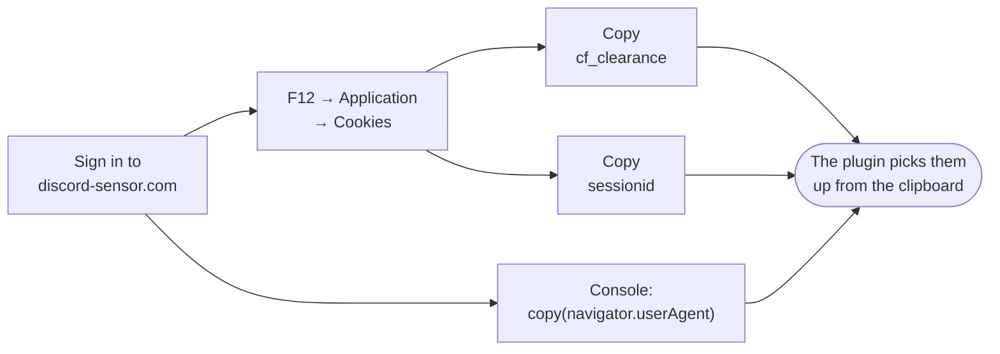

<div align="center">

**English** · [Русский](README.ru.md)

# SensorLookup

**A one-click profile of any Discord member, with data from [discord-sensor.com](https://discord-sensor.com) right inside the client.**

[](dist/SensorLookup.plugin.js)
[](https://betterdiscord.app)
[](src)
[](https://github.com/dxvxlery/sensor-lookup/releases/latest)
[](dist/SensorLookup.plugin.js)

[Features](#features) · [Install](#install) · [Tokens](#tokens) · [Updates](#updates) · [Usage](#usage) · [FAQ](#faq)

</div>

---

> [!NOTE]
> The plugin interface is in Russian.

## Features

Right-click a member → **Discord Sensor** to open their profile window.

|     | Tab           | What you get                                                                                                                                                                       |
| :-: | ------------- | ---------------------------------------------------------------------------------------------------------------------------------------------------------------------------------- |
| 🔊  | **Voice now** | The voice channel they are in right now, how long they've been there, who else is in it, mic and sound state. If they're not in voice, where they were last. Refreshes on its own. |
| 👤  | **Info**      | Time in voice, messages, reputation, roles across servers and comments about the person.                                                                                           |
| 🤝  | **Friends**   | Who they spend the most voice time with. Click a friend to see your shared voice sessions: where, when and for how long.                                                           |
| 🏷️  | **Nicknames** | Nickname history per server.                                                                                                                                                       |
| 🏰  | **Servers**   | Shared servers with member counts, messages and voice time. Searchable and sortable.                                                                                               |
| 🖼️  | **Media**     | Avatars, screen captures and deleted images, with a full-screen viewer.                                                                                                            |

<details>
<summary><b>Also</b></summary>

- Responses are cached for a while, so reopening a profile is instant.
- You can jump from a friend to their profile and back.
- If the site returns something unexpected, only that tab breaks — the rest of the window keeps working.
- It updates itself and shows what's new after an update.

</details>

## Install

> [!IMPORTANT]
> You need your own discord-sensor.com account and [BetterDiscord](https://betterdiscord.app) installed.

1. Download `SensorLookup.plugin.js` from the [latest release](https://github.com/dxvxlery/sensor-lookup/releases/latest).
2. Open Settings → **BetterDiscord** → **Plugins** → **Open Plugins Folder** and drop the file there.
3. Enable **SensorLookup** in the list.

## Tokens

The plugin talks to the site on your behalf, so it needs three values from the browser you're signed in with.



1. Open the plugin settings (gear icon) and press **Открыть сайт** (Open site).
2. Sign in and open anyone's profile.
3. Press <kbd>F12</kbd> → **Application** → **Cookies** → `discord-sensor.com`.
4. Double-click the `cf_clearance` value and press <kbd>Ctrl</kbd>+<kbd>C</kbd>, then do the same for `sessionid`.
5. In the **Console** tab run `copy(navigator.userAgent)`.

> [!TIP]
> There's nothing to paste. While the plugin settings are open, it notices copied values, saves them and clears the clipboard.

Then press **Проверить** (Check): the plugin makes a test request and tells you whether it works.

## Updates

The plugin checks for a new version 15 seconds after Discord starts and then every 6 hours, and asks before installing it. You can also press **Проверить** (Check) in the **Обновления** (Updates) section of the settings, or turn automatic checks off there. Every release is listed on the [releases page](https://github.com/dxvxlery/sensor-lookup/releases) and in the [changelog](CHANGELOG.md).

## Usage

- **Open a profile:** right-click a member in a server or DM → **Discord Sensor**.
- **Shared voice sessions:** **Friends** tab → click a friend.
- **Friend's profile:** the person button to the right of a friend.
- **Fresh data:** the refresh button above a tab.
- **Close:** <kbd>Esc</kbd> or click outside the window. In the media viewer use <kbd>←</kbd> <kbd>→</kbd>.

## FAQ

<details>
<summary><b>"Cloudflare blocked the request" or 403</b></summary>

`cf_clearance` lasts a few hours and is tied to your IP and browser. Reload the site in your browser and copy it again — nothing else needs to change. If you toggled a VPN, grab it again too.

</details>

<details>
<summary><b>No "Discord Sensor" item in the menu</b></summary>

Make sure the plugin is enabled and reload Discord (<kbd>Ctrl</kbd>+<kbd>R</kbd>).

</details>

<details>
<summary><b>The plugin doesn't pick values up from the clipboard</b></summary>

Press **Ввести** (Enter) next to the value and paste it manually. You can also paste a whole cURL of a request in the "Где взять значения" section of the settings.

</details>

<details>
<summary><b>Where are the tokens stored?</b></summary>

Only on your machine, in the BetterDiscord plugins folder. They are sent only to discord-sensor.com.

</details>

> [!CAUTION]
> Never share `SensorLookup.config.json`: the `sessionid` in it gives access to your account on the site.

<details>
<summary><b>Building from source</b></summary>

```powershell
docker run --rm -v "${PWD}:/app" -v sensor-bd-nm:/app/node_modules -w /app node:22 sh -c "npm ci && npm run check"
```

The built file ends up in `dist/`.

</details>

---

<div align="center"><sub>Data comes from discord-sensor.com. This plugin is not affiliated with the site.</sub></div>
