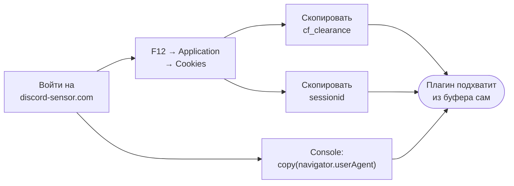

<div align="center">

[English](README.md) · **Русский**

# SensorLookup

**Досье на участника Discord в один клик: данные с [discord-sensor.com](https://discord-sensor.com) прямо в клиенте.**

[](dist/SensorLookup.plugin.js)
[](https://betterdiscord.app)
[](src)
[](https://github.com/dxvxlery/sensor-lookup/releases/latest)
[](dist/SensorLookup.plugin.js)

[Возможности](#возможности) · [Установка](#установка) · [Токены](#токены) · [Обновления](#обновления) · [Использование](#использование) · [Вопросы](#вопросы)

</div>

---

## Возможности

Правый клик по участнику → **SensorLookup**, и открывается окно профиля.

|     | Вкладка        | Что показывает                                                                                                                                                                   |
| :-: | -------------- | -------------------------------------------------------------------------------------------------------------------------------------------------------------------------------- |
| 🔊  | **Где сейчас** | В каком голосовом канале человек прямо сейчас, сколько там сидит, с кем, включены ли микрофон и звук. Если он не в войсе, показывается, где был последний раз. Обновляется само. |
| 👤  | **Инфо**       | Время в войсе, сообщения, репутация, роли на серверах и комментарии о человеке.                                                                                                  |
| 🤝  | **Друзья**     | С кем больше всего сидит в войсе. Можно сортировать по времени вместе или по тому, как давно были вместе. Клик по другу раскрывает ваши совместные каналы: где, когда, сколько.  |
| 🕒  | **События**    | История голосовых каналов (по дате или длительности) и входов-выходов на серверах. Клик по голосовой сессии показывает, кто ещё был в канале.                                    |
| 🏷️  | **Ники**       | История ников по серверам.                                                                                                                                                       |
| 🏰  | **Серверы**    | Общие серверы: участники, сообщения, время в войсе. Можно искать и сортировать.                                                                                                  |
| 🖼️  | **Медиа**      | Аватары, скриншоты экрана и удалённые картинки. Есть просмотр на весь экран.                                                                                                     |

<details>
<summary><b>А ещё</b></summary>

- Ответы сохраняются на время, так что повторное открытие профиля мгновенное.
- Из друзей можно перейти в профиль друга и вернуться назад.
- Если сайт ответил чем-то странным, ломается только одна вкладка, остальное окно работает.
- Плагин обновляется сам и после обновления показывает, что нового.

</details>

## Установка

> [!IMPORTANT]
> Нужен свой аккаунт на discord-sensor.com и установленный [BetterDiscord](https://betterdiscord.app).

1. Скачай `SensorLookup.plugin.js` из [последнего релиза](https://github.com/dxvxlery/sensor-lookup/releases/latest).
2. Открой Настройки → **BetterDiscord** → **Плагины** → **Открыть папку плагинов** и положи туда файл.
3. Включи **SensorLookup** в списке.

## Токены

Плагин обращается к сайту от твоего имени, поэтому ему нужны три значения из браузера, где ты вошёл на сайт.



1. Открой настройки плагина (шестерёнка) и нажми **Открыть сайт**.
2. Войди и открой профиль любого человека.
3. Нажми <kbd>F12</kbd> → **Application** → **Cookies** → `discord-sensor.com`.
4. Дважды кликни по значению `cf_clearance` и нажми <kbd>Ctrl</kbd>+<kbd>C</kbd>, затем то же для `sessionid`.
5. Во вкладке **Console** выполни `copy(navigator.userAgent)`.

> [!TIP]
> Вставлять ничего не нужно. Пока открыты настройки плагина, он сам замечает скопированные значения, сохраняет их и очищает буфер обмена.

После этого нажми **Проверить**: плагин сделает пробный запрос и скажет, работает ли.

## Обновления

Плагин проверяет новую версию через 15 секунд после запуска Discord и затем раз в 6 часов, а перед установкой спрашивает. Проверить вручную или выключить автопроверку можно в настройках, раздел «Обновления». Все релизы есть на [странице релизов](https://github.com/dxvxlery/sensor-lookup/releases) и в [списке изменений](CHANGELOG.md) (на английском).

## Использование

- **Открыть профиль:** правый клик по участнику на сервере или в ЛС → **SensorLookup**.
- **Совместные войсы:** вкладка «Друзья» → клик по другу.
- **Кто был в канале:** вкладка «События» → клик по голосовой сессии.
- **Профиль друга:** кнопка с человечком справа от друга.
- **Свежие данные:** кнопка «обновить» над вкладкой.
- **Закрыть:** <kbd>Esc</kbd> или клик мимо окна. В просмотре медиа листать можно <kbd>←</kbd> <kbd>→</kbd>.

## Вопросы

<details>
<summary><b>Пишет «Cloudflare не пустил» или 403</b></summary>

`cf_clearance` живёт несколько часов и привязана к IP и браузеру. Обнови сайт в браузере и скопируй её заново, остальное менять не нужно. Если включал или выключал VPN, тоже бери заново.

</details>

<details>
<summary><b>Не видно пункта «SensorLookup»</b></summary>

Проверь, что плагин включён, и перезапусти Discord (<kbd>Ctrl</kbd>+<kbd>R</kbd>).

</details>

<details>
<summary><b>Плагин не ловит значения из буфера</b></summary>

Нажми **Ввести** рядом с нужным значением и вставь его вручную. Ещё можно вставить cURL запроса целиком: в настройках есть раздел «Где взять значения».

</details>

<details>
<summary><b>Где хранятся токены</b></summary>

Только у тебя, в папке плагинов BetterDiscord. Отправляются они только на discord-sensor.com.

</details>

> [!CAUTION]
> Не пересылай никому файл `SensorLookup.config.json`: по `sessionid` можно войти в твой аккаунт на сайте.

<details>
<summary><b>Сборка из исходников</b></summary>

```powershell
docker run --rm -v "${PWD}:/app" -v sensor-bd-nm:/app/node_modules -w /app node:22 sh -c "npm ci && npm run check"
```

Готовый файл появится в `dist/`.

</details>

---

<div align="center"><sub>Данные берутся с discord-sensor.com, плагин с сайтом не связан.</sub></div>
